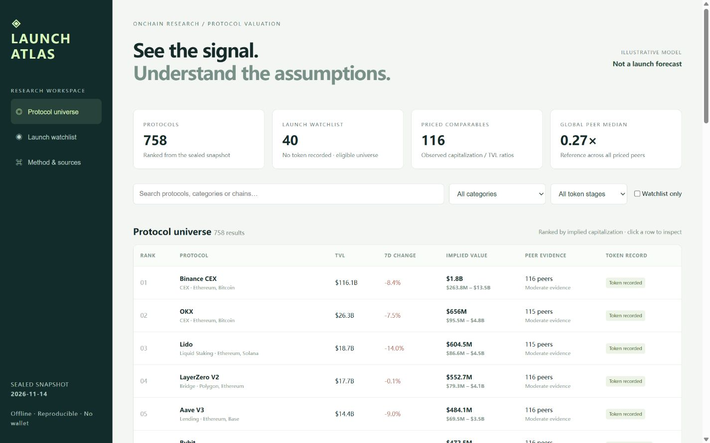

# Launch Atlas

[中文](#中文) · [English](#english)

## 中文

离线协议研究看板，按赛事快照展示指标、分层排序和观察名单。

### 本地运行

使用 Node.js 22.18 或更新版本。运行 `node main.ts --input <snapshot.json> --output <输出目录>` 生成看板。输入快照由赛事或使用者提供。

运行 `node main.ts --input examples/snapshot.json --output out --preview` 可以用模拟数据试用，完成后用浏览器打开 `out/dashboard/index.html`。

看板默认显示中文，右上角可切换语言。

命令行提示默认显示中文。设置 `MAKEFUN_UI_LANG=en` 可显示英文。

## English

An offline protocol research dashboard that ranks and explores entries from a supplied data snapshot.

### Run locally

Use Node.js 22.18 or newer. Run `node main.ts --input <snapshot.json> --output <output-dir>` to build the dashboard from a challenge-format snapshot.

Run `node main.ts --input examples/snapshot.json --output out --preview` with the included synthetic snapshot, then open `out/dashboard/index.html`.

The dashboard opens in Simplified Chinese. Use the language menu in the upper right to switch.

Set `MAKEFUN_UI_LANG=en` for English terminal messages.

[中文技术说明](README.details.zh.md) · [English technical notes](README.details.md)

[make.fun 赛事 / Original bounty](https://make.fun/bounty/token-radar-01)

## 许可证 / License

MIT. See [LICENSE](LICENSE).

赛事模板组件的授权见 [LICENSE-makefun.txt](LICENSE-makefun.txt)。

Kit components are covered by [LICENSE-makefun.txt](LICENSE-makefun.txt).

